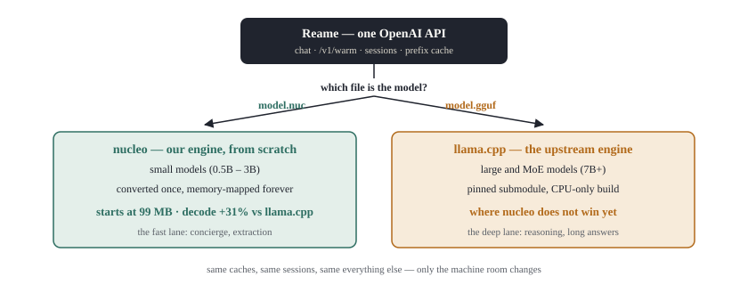
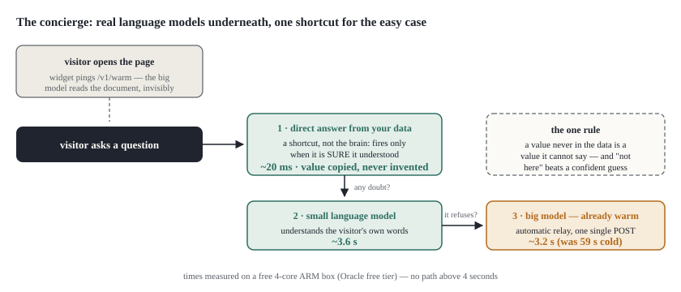
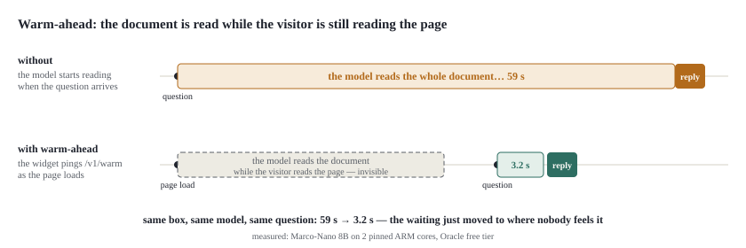

<p align="center">
  
</p>

<p align="center">
  <a href="https://swellweb.github.io/reame/"><b>▶ Try the live demo</b></a> — a real Reame instance serving an LLM from a free Oracle ARM box, in your browser.
</p>

**Reame is an LLM server for ordinary CPUs — the office PC, a €5 VPS, a
free-tier cloud box. Your data stays on your machine, and the server gets
faster the longer it works for you.**

> **Your local LLM re-reads the same text a thousand times.
> Reame reads it once.**

No GPU. No per-token bill. One OpenAI-compatible API that any existing
client can talk to, with two engines underneath: **nucleo**, our own
engine written from scratch for small models — where it beats llama.cpp —
and **[llama.cpp](https://github.com/ggml-org/llama.cpp)** for the big ones.



---

## What can I do with it?

### Put a concierge on your website

The flagship use. A visitor writes *"how much would that smooth floor cost
for my living room?"* — your price list calls it "self-levelling epoxy
resin for residential interiors", and the visitor neither knows nor cares.
Reame understands that this is what they are asking, and answers "€35.00
per m²" in seconds, from a free-tier box.

That is what a keyword bot cannot do: bots match rules, and die on the
first question phrased in the visitor's own words. Underneath Reame there
are real language models — a small one living on the free box, a big one
for the hard questions — and no rules to write: feed it your data, and
questions arrive the way people actually type them.

On top of that, one guarantee a bare LLM cannot give: when the answer *is*
your data (a price, a phone number, an opening time), Reame does not let
the model generate it — it copies it from your data, verbatim. Inventing a
price is not unlikely; it is impossible. And when the answer is not in
your data, it says so instead of guessing.



### And the rest

| You want to… | Reame gives you |
|---|---|
| extract data from documents (invoices, tickets, pages) | small model + disk cache: repeated work becomes nearly free |
| run overnight batch jobs (tag 10k products, triage email) | €0 per token, no rate limits, no data leaving |
| add AI to a thin-margin SaaS | a €5 VPS instead of a metered API |
| keep legal/medical/public-sector data private | everything runs and stays on your server |
| private code autocomplete | an OpenAI-compatible endpoint for Continue.dev |

**Not for**: replacing ChatGPT as an all-rounder, agentic coding, creative
long-form writing. Small models on CPUs shine on narrow work over *your*
context — that is the niche, and it is a big one.

---

## Get started

```bash
brew tap swellweb/reame && brew install reame     # or: releases page, or build below
reame run qwen2.5-1.5b                            # download once, chat
reame run qwen2.5-1.5b --serve                    # OpenAI API on :8080
```

```bash
curl http://127.0.0.1:8080/v1/chat/completions -d '{
  "model": "reame",
  "messages": [{"role": "user", "content": "Ciao!"}]
}'
```

That is genuinely all. A config file exists for when you want control —
see [Configuration](#configuration).

<details>
<summary><b>Build from source</b></summary>

```bash
git clone https://github.com/swellweb/reame
cd reame
git submodule update --init --depth 1 third_party/llama.cpp
./build.sh          # Release build + full test suite
```

Dependencies: CMake ≥ 3.16, C++17, Boost headers, nlohmann-json, zstd.

```bash
# Debian/Ubuntu
sudo apt install build-essential cmake libboost-dev nlohmann-json3-dev libzstd-dev pkg-config
# macOS
brew install cmake boost nlohmann-json zstd pkg-config
```
</details>

---

## How it works, in plain words

Four ideas, each one measured. Everything else is plumbing.

**1 — Convert once, never again.** Most runtimes re-organize the model's
weights every time the server starts: minutes of work, gigabytes of RAM,
repeated forever. Reame's own engine does that work **once**, in a
converter, and saves the result as a `.nuc` file. The server just opens it:
**99 MB of RAM at startup**, ready in a blink, on the smallest box you have.

**2 — Never read the same thing twice.** Every piece of text the model
reads is expensive on a CPU. So Reame snapshots what it read onto disk
(the *prefix cache*) and reuses it — across requests, across restarts,
across different prompts that share a beginning. An identical request
answers in half a second.


**3 — Read ahead, while nobody is waiting.** The moment a visitor opens
your page, the widget tells Reame (`/v1/warm`) — and the big model reads
the document *while the visitor is still reading the page*. When the
question arrives, the expensive part is already done.



**4 — Understand with models, answer with data.** The language
understanding comes from real LLMs — that is what survives questions
phrased in the visitor's own words, where rule bots break. But the
*values* in the answers come from your data, copied verbatim, so invention
is impossible by construction. And the common, unambiguous case takes a
shortcut past the models entirely (~20 ms); anything uncertain flows to
the small model, and what that refuses climbs to the big one on its own,
through the `[escalation]` relay. No path takes more than a few seconds.

---

## The numbers

Every figure measured on the hardware named, by the shipped binary — the
exact method for each is in **[docs/BENCHMARKS.md](docs/BENCHMARKS.md)**,
negative results included.

| What | Measured | Where |
|---|---|---|
| nucleo vs llama.cpp, same 0.5B model | **+31% decode** (35.4 vs 27.2 tok/s) | Oracle free tier |
| RAM at startup, no repacking | **99 MB** | Oracle free tier |
| question on a pre-warmed document | 59 s cold → **3.2 s** | Oracle free tier |
| concierge selector (no model in the loop) | **~20 ms**, invented values: impossible | M3 laptop |
| identical request, warm cache | **0.5 s** | Oracle free tier |
| better input format vs bigger model | **~6× faster**, higher score | Oracle free tier |

---

## Configuration

```ini
[model]
path = models/qwen2.5-0.5b.nuc   ; .nuc → nucleo engine, .gguf → llama.cpp
context_length = 4096
threads = 4                      ; fewer is often faster on shared vCPUs — measure!

[cache]
directory = .reame-cache
max_size_mb = 4096               ; disk budget for the prefix snapshots

[server]
port = 8080
api_key =                        ; bearer auth when set
parallel = 1                     ; >1 = interleaved multi-user serving

[escalation]                     ; the relay to a bigger model (optional)
endpoint = http://127.0.0.1:8081/v1/chat/completions
trigger = NON PRESENTE           ; regex; a blank answer always escalates
model_id = big-model
```

When the small model's answer matches the trigger, the same request is
replayed on the deep endpoint and *its* answer comes back, flagged
`"escalated": true`. If the deep road fails, the fast answer stands — the
relay can only improve a response.

## API

| Endpoint | What it does |
|---|---|
| `POST /v1/chat/completions` | chat (SSE streaming with `"stream": true`) |
| `POST /v1/completions` | plain completion |
| `POST /v1/warm` | pre-read a `prompt` or `messages` prefix, so the real request starts warm |
| `POST /v1/sessions` + save/load | snapshot and restore a conversation |
| `GET /metrics` · `GET /health` | counters · liveness |

---

## The honest part

We publish what failed next to what worked — it is half the value:

- **Similarity cannot detect absence.** Embedding scores of "answerable"
  and "not in the data" questions overlap almost completely (medians 0.895
  vs 0.879). That is why the concierge *computes* its refusals from
  evidence instead of predicting them from scores.
- **Sliding-window attention imposed at inference collapses** (3/20 on our
  fact exam): Inkling-style 5:1 hybrid attention works because it is
  trained in, not bolted on. Measured, published, shelved.
- **Fewer MoE experts pay in prefill (+44%, quality intact), not in decode**
  (+19% but hallucinations triple; at K=2 the model collapses to 0/20).
  Read with few, write with all.
- **Speculation on oversubscribed vCPUs is counter-productive** — Reame
  measures it and turns itself off.

More in [BENCHMARKS](docs/BENCHMARKS.md) and [ROADMAP](docs/ROADMAP.md).

## When to use something else

**Ollama** is the right tool for trying many models on a laptop with zero
friction — most people should use it, and Reame does not compete there.
**vLLM / SGLang** are the right tools if you have GPUs. Reame is for the
other case: one workload, repeated, on cheap CPU hardware — where its
cost per request *falls* the longer it serves, which is the opposite of a
per-token API bill.

## Support

Free, MIT, built on nights and free-tier hardware. If it saves you API
bills or GPU rent, consider [sponsoring](https://github.com/sponsors/swellweb).

## Acknowledgments

The big-model lane stands on [llama.cpp](https://github.com/ggml-org/llama.cpp)
(MIT) — excellent engineering, credited gladly. The nucleo engine is ours,
verified token-by-token against an independent reference implementation.
The disk-first cache thesis owes a debt to antirez's DwarfStar4 thinking;
the speculative pipeline to the Leviathan/Chen theorem. Ideas are cited,
numbers are ours. The demo model is
[ATH-MaaS/Marco-Nano-Instruct](https://huggingface.co/ATH-MaaS/Marco-Nano-Instruct)
(Apache-2.0) — the name is a coincidence, not an attribution.

Documentazione in italiano: [docs/README.it.md](docs/README.it.md).

## License

[MIT](LICENSE).
